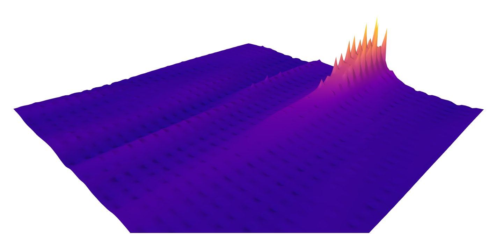

# Leviathan: Autonomous Ocean Floor Mapping

A small-scale prototype for low-cost, autonomous ocean floor mapping. A three-person team built it for the UVic Ocean Challenge (December 2023) with financial support from CCIC, and it was then developed further through an **Ocean Wise Ocean Action Grant** (2023 cohort).

▶️ **[Watch the project video](https://youtu.be/DAT3OCopGBU)** · 🌊 **[Ocean Wise project page](https://ocean.org/project/leviathan-prototype-development/)**



## System

- **Sensing:** a Raspberry Pi reads depth from a waterproof HC-SR04 ultrasonic (sonar) sensor and position from a NEO-6M GPS module.
- **Data:** readings stream to a Node.js server hosted on the Pi.
- **Visualization:** depth, latitude, and longitude are interpolated onto a grid and rendered as an interactive 3D topographic map with Plotly.

## Terrain mapping code

| File | Purpose |
| --- | --- |
| `terrain-mapping/coordinateDataSetGen.py` | Generates a grid of survey coordinates inside a polygon survey area (Shapely) |
| `terrain-mapping/terrainSurface.py` | Interpolates depth readings onto a regular grid with inverse distance weighting (IDW) and renders an interactive 3D surface (Plotly) |
| `terrain-mapping/eggs.csv`, `mapData.csv` | Sample survey-area points and a sample deep-ocean bathymetry dataset |
| `terrain-mapping/*.html` | Interactive 3D terrain maps generated by the script. Download one and open it in a browser to rotate and zoom |

```bash
pip install numpy plotly shapely
python terrainSurface.py   # reads eggs.csv, writes 3d_terrain_plot.html
```

## Documents

- `docs/Leviathan_Poster.pdf`: project poster
- `docs/Leviathan_Project_Report.docx`: full design report (requirements, architecture, UML, test cases)

## Team

**Benjamin Philipenko** (project lead: UI design, testing and validation, data analysis) · [benphilipenko.ca](https://benphilipenko.ca/leviathan), with Jairus and Hailey, mentored by Andrew Polanyi.
